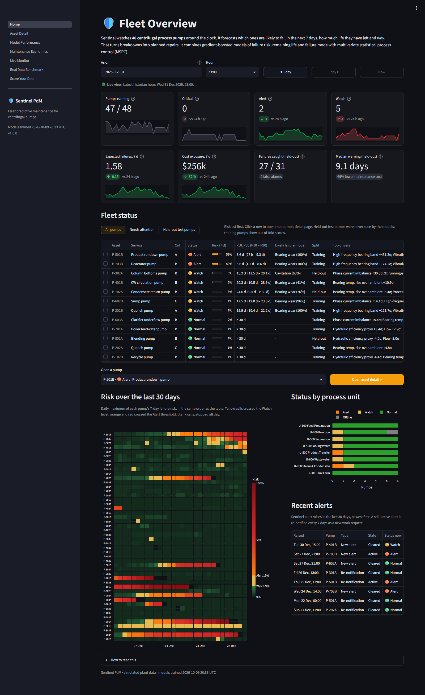
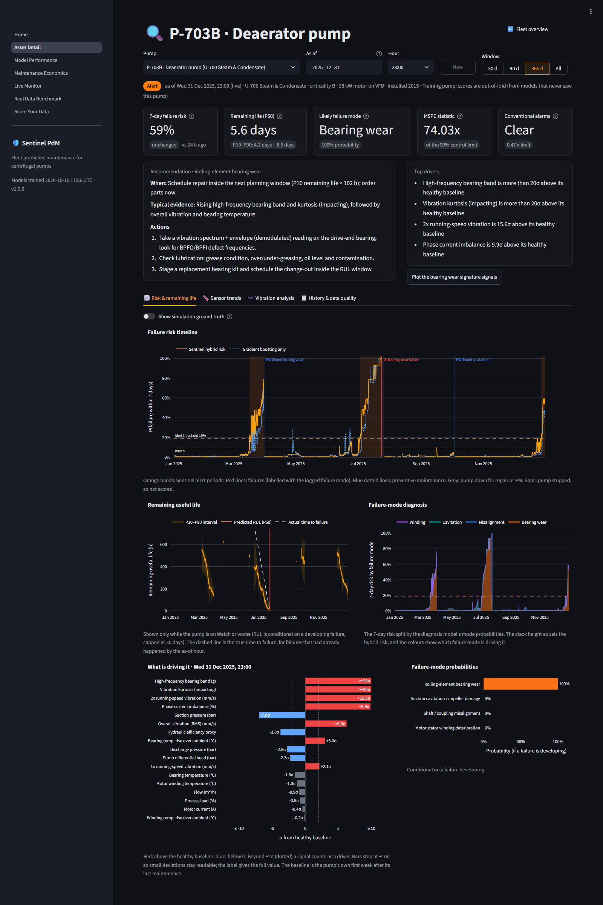
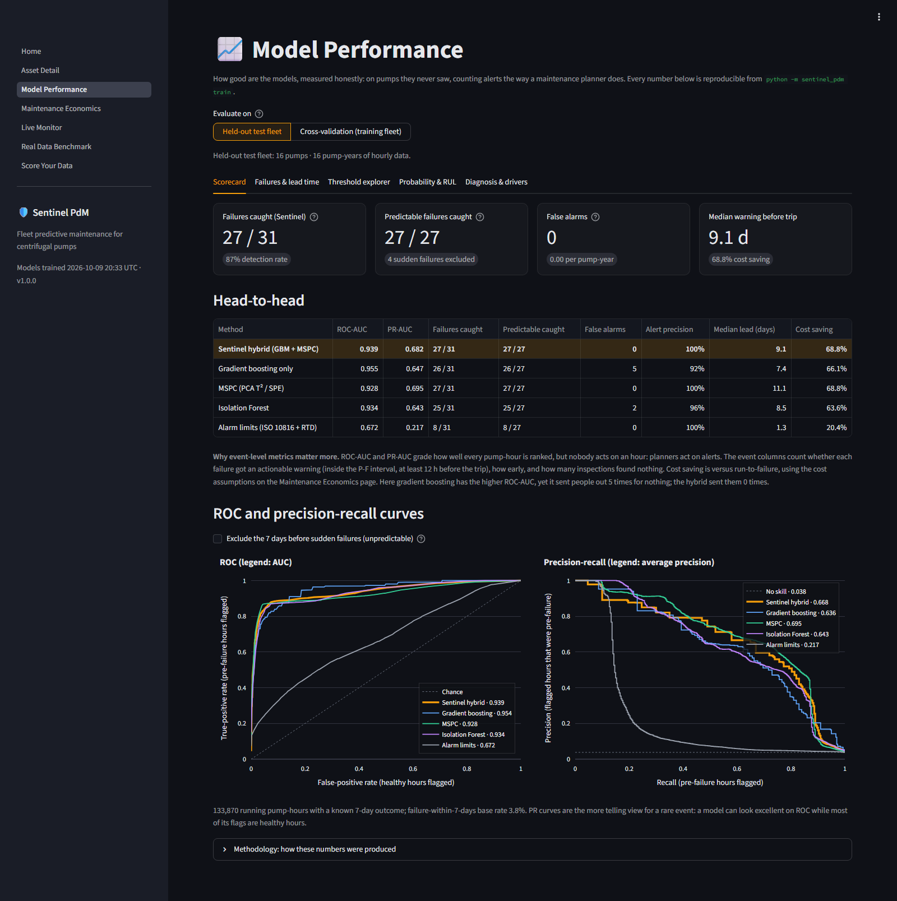
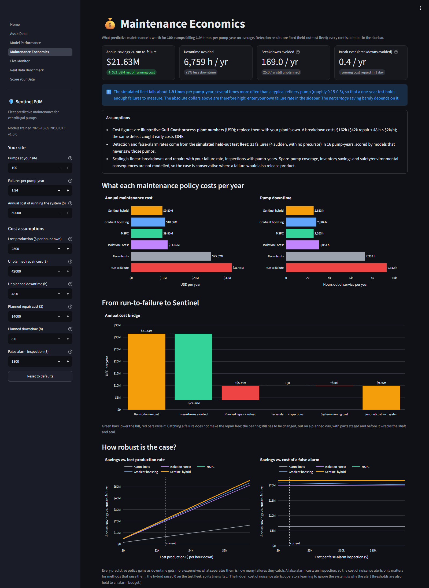
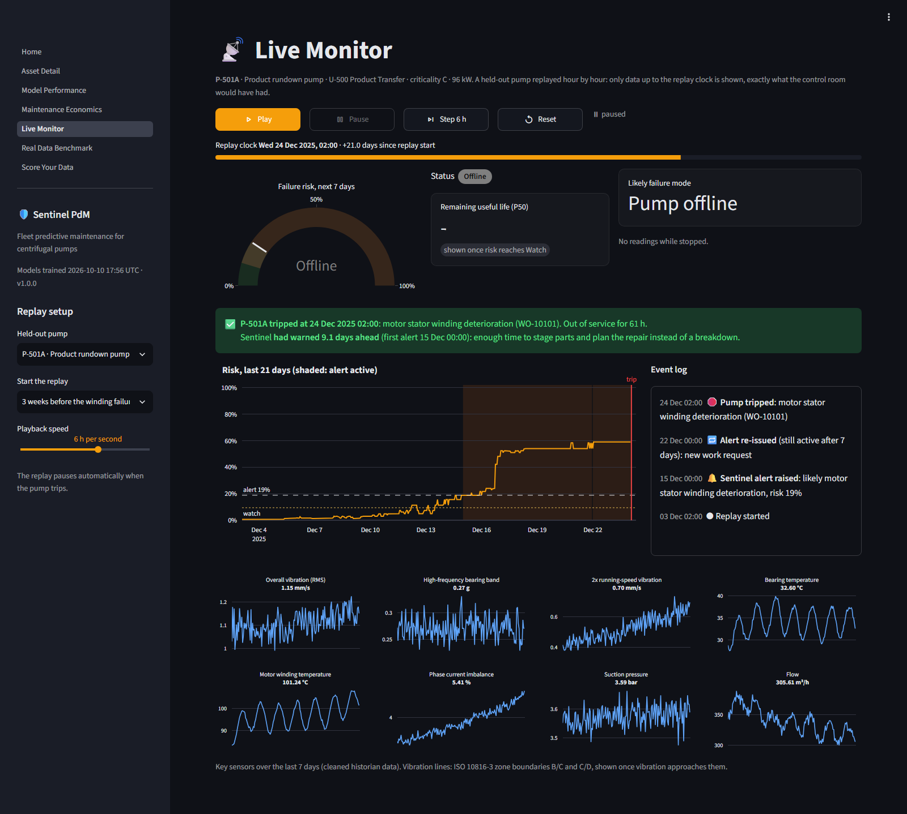
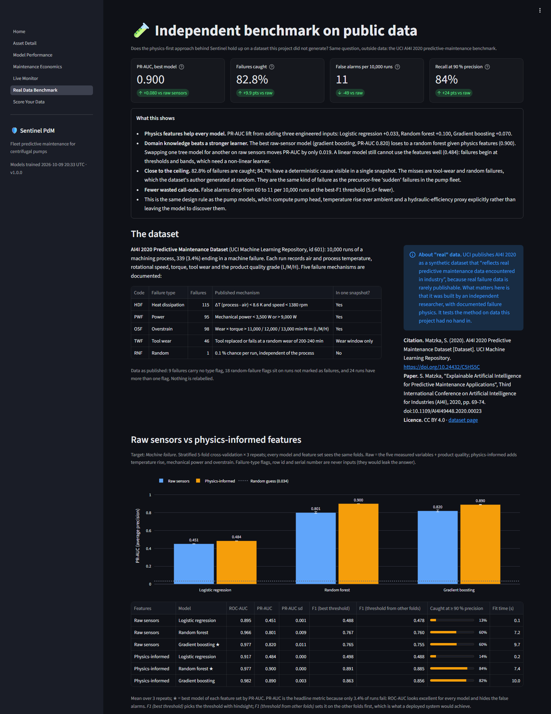
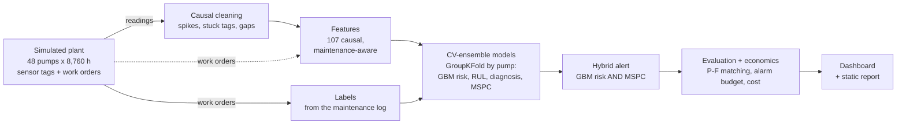

# Sentinel PdM

**Predictive maintenance for a fleet of industrial centrifugal pumps: it flags developing bearing,
alignment, cavitation and winding failures days before they trip the pump, estimates the remaining
life, names the likely failure mode, and keeps nuisance alarms inside an explicit alarm budget.**

[](https://www.python.org/downloads/)
[](LICENSE)
[](https://github.com/DaitenGarza/sentinel-pdm/actions/workflows/ci.yml)



Sentinel PdM monitors 48 process pumps hour by hour, the way a reliability engineer would if they had
time to trend every tag: vibration, bearing and winding temperatures, motor current, pressures and
flow, read against each pump's own healthy baseline and its maintenance history. Every alert is a
work request for an inspection, with the signals that triggered it, the most likely failure mode, a
remaining-life window and a recommended action.

It is evaluated the way a maintenance organisation experiences a monitoring system: failures caught
with time to plan, warning time, false alarms per pump-year and maintenance cost, on pumps the models
never saw, against the conventional alarm limits most plants run today. The plant is simulated
(real run-to-failure data with matching work orders is proprietary), so the project also repeats the
whole experiment on five independent fleets and checks its central idea on public data.

---

## Results at a glance

### Five independent fleets: 150 held-out failures, 80 pump-years

The entire pipeline was re-run on five statistically independent simulated fleets (new pumps,
operating histories, failures and train/test split each time), evaluated on 16 held-out pumps per
fleet. 124 of the 150 failures had a measurable precursor; the other 26 were sudden failures that
no sensor can see coming.

| Method | Predictable failures caught | False alarms (80 pump-years) | Median warning | Cost saving vs run-to-failure |
|---|---:|---:|---:|---:|
| **Sentinel hybrid (GBM + MSPC)** | **124 / 124** | **2** | **281 ± 47 h** (11.7 days) | **65.6 ± 6.6 %** |
| Gradient boosting only | 120 / 124 | 10 | 239 ± 32 h | 63.4 ± 8.0 % |
| MSPC (PCA T² / SPE) only | 124 / 124 | 15 | 236 ± 14 h | 65.5 ± 6.7 % |
| Isolation Forest | 117 / 124 | 36 | 195 ± 64 h | 61.7 ± 7.8 % |
| Conventional alarm limits (ISO 10816 + RTD) | 43 / 124 | 0 | 64 ± 15 h (2.7 days) | 22.8 ± 4.2 % |

* The hybrid caught **every predictable failure on every fleet** with **2 false alarms in 80
  pump-years** (0.03 per pump-year, against a budget of 0.5). Conventional alarm limits caught 43 of
  124, usually with too little warning to plan the repair.
* Requiring the supervised model and the statistical monitor to agree is what removes the nuisance
  alerts: each one alone raised 5 to 7.5 times as many false alarms for the same or fewer catches.
* ± is the standard deviation across fleets. Full tables: [reports/ROBUSTNESS.md](reports/ROBUSTNESS.md).

### Reference run: held-out test fleet (16 pumps, 31 failures, 27 predictable)

| Method | ROC-AUC | PR-AUC | Failures caught | Predictable caught | False alarms | Median warning | Cost saving |
|---|---:|---:|---:|---:|---:|---:|---:|
| **Sentinel hybrid (GBM + MSPC)** | 0.939 | 0.682 | **27 / 31** | **27 / 27** | **0** | 9.1 days | **68.8 %** |
| Gradient boosting only | 0.955 | 0.647 | 26 / 31 | 26 / 27 | 5 | 7.4 days | 66.1 % |
| MSPC (PCA T² / SPE) only | 0.928 | 0.695 | 27 / 31 | 27 / 27 | 0 | 11.1 days | 68.8 % |
| Isolation Forest | 0.934 | 0.643 | 25 / 31 | 25 / 27 | 2 | 8.5 days | 63.6 % |
| Conventional alarm limits | 0.672 | 0.217 | 8 / 31 | 8 / 27 | 0 | 1.3 days | 20.4 % |

At the stated (illustrative) costs the hybrid cuts the test fleet's maintenance cost from $5.02M to
$1.57M against run-to-failure, and failure downtime by 72.6 %. The four failures it missed are the
four sudden ones.

### Remaining life and diagnosis

| | Reference test fleet | Five fleets |
|---|---:|---:|
| Remaining-life error (MAE of P50), last 7 days before failure | 98 h | 78 ± 15 h |
| P10-P90 interval coverage, last 7 days (target 80 %) | 71 % | 83.6 ± 6.2 % |
| Failure mode diagnosed correctly | 24 / 27 (89 %) | 90.3 ± 7.2 % |

### Real-data check: UCI AI4I 2020

On the public AI4I 2020 predictive-maintenance dataset (10,000 machining runs, 339 failures), three
physics-informed features (temperature rise, mechanical power, tool wear x torque) matter more than
the choice of model:

| Features (best model) | PR-AUC | F1 (cross-fitted threshold) | Recall at 90 % precision | False alarms per 10,000 runs |
|---|---:|---:|---:|---:|
| Raw sensors (gradient boosting) | 0.820 | 0.755 | 60 % | 60 |
| **Physics-informed (random forest)** | **0.900** | **0.885** | **84 %** | **10.7** |

3 x repeated stratified 5-fold cross-validation; false alarms at each model's best-F1 threshold. Only
287 of the 339 failures (85 %) follow a mechanism that a single snapshot of the inputs can reveal,
which caps any model.

Every number above is copied from files the code writes (`artifacts/metrics.json`,
`reports/robustness.json`, `artifacts/ai4i_metrics.json`). Full report:
[reports/RESULTS.md](reports/RESULTS.md); interactive version with figures:
[reports/model_report.html](reports/model_report.html) (open it in a browser).

---

## Quick start

Needs a 64-bit Python 3.10 or newer and an internet connection for the first install. No GPU, cloud
account or API key.

### Windows

1. Download the repository (**Code > Download ZIP**, then extract it) or clone it:
   `git clone https://github.com/DaitenGarza/sentinel-pdm.git`
2. Double-click **`setup.bat`**. The first run takes about 5 minutes: it creates a virtual environment
   and installs the packages (about 140 MB download, about 600 MB on disk), simulates the plant, trains
   and evaluates every model, and downloads the AI4I dataset for the real-data benchmark. If Python is
   missing it offers to install it with winget. Re-running it later also works offline.
3. Double-click **`run.bat`**. The dashboard opens in your browser at http://localhost:8501 (or the
   next free port) after about 5 seconds. Close the window or press Ctrl+C to stop it.

`run.bat` also works on its own: on a fresh copy it runs the setup first. The dashboard listens on
localhost only, so it never triggers a firewall prompt and is not reachable from other machines.

### macOS / Linux

```bash
bash setup.sh     # one-time: virtual environment, packages, training, AI4I benchmark
bash run.sh       # start the dashboard
```

### Manual

```bash
python -m venv .venv
.venv\Scripts\activate             # Windows; on macOS / Linux: source .venv/bin/activate
pip install -e ".[dev]"
python -m sentinel_pdm train       # simulate the plant, train and evaluate (about 2-3 minutes)
python -m sentinel_pdm ai4i        # real-data benchmark (downloads about 0.5 MB)
python -m sentinel_pdm app         # dashboard at http://localhost:8501
```

---

## Dashboard tour

Seven pages, all reading the artifacts of the last training run. The fleet and asset pages can be
replayed at any past hour, using only data up to that hour.

1. **Fleet Overview**: which pumps need attention now, how bad, since when, and what is failing.
2. **Asset Detail**: one pump on one screen: risk and remaining-life timeline, driver signals, sensor
   trends with ISO 10816 zones, vibration spectrum and envelope with bearing defect frequencies, and
   the recommended action.
3. **Model Performance**: held-out and cross-validation scorecards, every failure with its warning
   time, a live threshold explorer, calibration, remaining-life accuracy and diagnosis.
4. **Maintenance Economics**: the business case in your own numbers: edit every cost assumption,
   your fleet size and failure rate, and every policy is recomputed.
5. **Live Monitor**: replay a held-out pump hour by hour, from the quiet weeks to the first alert,
   the work order and the trip.
6. **Real Data Benchmark**: the AI4I 2020 study: raw tags against physics-informed features.
7. **Score Your Data**: upload a historian export (CSV) and, optionally, a maintenance log, and score
   it with the trained models; a sample file is provided.

<table>
  <tr>
    <td width="50%"><br><sub><b>Asset Detail</b>: work an alert from risk to evidence</sub></td>
    <td width="50%"><br><sub><b>Model Performance</b>: events, lead time and the threshold explorer</sub></td>
  </tr>
  <tr>
    <td width="50%"><br><sub><b>Maintenance Economics</b>: policy cost with editable assumptions</sub></td>
    <td width="50%"><br><sub><b>Live Monitor</b>: hour-by-hour replay of a held-out pump</sub></td>
  </tr>
  <tr>
    <td width="50%"><br><sub><b>Real Data Benchmark</b>: physics-informed features on AI4I 2020</sub></td>
    <td width="50%"><br><sub><b>Fleet Overview</b>: the control-room view, replayable at any hour</sub></td>
  </tr>
</table>

---

## How it works



For every running pump-hour the models produce the probability of failure within 7 days, remaining
life (P10 / P50 / P90 hours), the probabilities of four failure modes, the signals that drive the
risk, and a status (Critical / Alert / Watch / Normal / Offline). The whole pipeline runs on an
ordinary CPU in about two minutes. Details:

* [docs/METHODOLOGY.md](docs/METHODOLOGY.md): how it works and why, with full results;
* [docs/ARCHITECTURE.md](docs/ARCHITECTURE.md): modules, APIs and file schemas;
* [docs/MODEL_CARD.md](docs/MODEL_CARD.md): intended use, metrics, limitations and retraining.

---

## Engineering decisions that matter

* **Held-out pumps, grouped cross-validation.** Hourly rows of one pump are near-duplicates, so a
  random split leaks the answer. 16 pumps are never seen by any model; inside the training fleet
  every model is cross-validated by pump, and everything tuned (calibration, thresholds, conformal
  offsets) is tuned on out-of-fold scores.
* **Causal, maintenance-aware features.** Every feature uses only past data, and the cleaning is
  causal too, so the back-test is exactly what would have run online (the tests perturb the future
  and assert the past does not move). Rolling windows restart at every work order, so a repaired pump
  does not inherit its pre-failure trend; each pump is compared with its own post-maintenance
  baseline, scale-free, so models transfer to pumps of other sizes.
* **Operating-point awareness.** An early version raised false alarms on P-302A, a healthy VFD pump
  whose load rose from about 77 % to 85-99 %: head, flow and current all moved along the pump curve.
  Process load is now a feature, and MSPC models the healthy correlation between load and the
  hydraulics, so a coherent move along the curve is not a fault. Gradient boosting alone still raised
  4 false alarms on that pump; the hybrid raised none.
* **Evaluation on the P-F interval.** An alert counts only if it lands after the defect became
  detectable (P) and at least 12 h before functional failure (F). Earlier alerts are false alarms
  (the inspection would find nothing), later ones are too late to plan, and a still-active alert
  re-notifies weekly, so an always-on score cannot game the count.
* **An explicit alarm budget.** In the spirit of ISA-18.2 and EEMUA 191, at most 0.5 false alarms per
  pump-year; within it, thresholds minimise maintenance cost. Operators ignore a system that cries
  wolf, so nuisance alarms are a constraint, not a footnote.
* **Cross-validation ensembles, not a refit.** Thresholds are tuned on out-of-fold scores, and a
  model refitted on all training pumps has a different score distribution: at the same threshold it
  raised 11 test-fleet false alarms instead of 5. Production averages the fold models it was tuned on.
* **Hybrid of machine learning and MSPC.** Gradient boosting knows what failures look like but
  over-reacts to unusual-but-healthy operation; MSPC is robust to operating changes but fires on any
  broken correlation. Their false alarms have different causes, so the hybrid requires both: 2 false
  alarms across five fleets, against 10 and 15 for each alone.
* **Conformal remaining life.** Remaining life is predicted conditionally (given a developing
  failure) with quantile regression, and the P10-P90 interval is calibrated with Mondrian normalised
  conformal prediction: 83.6 ± 6.2 % coverage across five fleets against an 80 % target.
* **Physics features, checked on outside data.** Head, temperature rise and a hydraulic-efficiency
  proxy for the pumps; on AI4I 2020, three physics features lift PR-AUC from 0.820 to 0.900, while
  switching between tree models on raw tags moves it by 0.02.
* **Honesty about what cannot be predicted.** About one failure in eight is simulated with no
  precursor. Those failures stay in every denominator and are reported separately; the AI4I study
  states its 85 % mechanism ceiling the same way.

---

## Command-line reference

| Command | What it does |
|---|---|
| `python -m sentinel_pdm train` | Simulate the plant, train and evaluate every model, write `data/` and `artifacts/` (about 2-3 min). Options: `--quick` (small fleet for a smoke run), `--assets N`, `--hours H`, `--seed S`, `--no-importance` |
| `python -m sentinel_pdm summary` | Print the headline results of the last run |
| `python -m sentinel_pdm ai4i` | Real-data benchmark on UCI AI4I 2020; downloads once to `data/external/` (`--offline` to use the cached copy) |
| `python -m sentinel_pdm robustness` | Repeat the whole experiment on independent fleets, write `reports/ROBUSTNESS.md` and `reports/robustness.json`. Options: `--seeds 5`, `--first-seed 101`, `--quick` |
| `python -m sentinel_pdm report` | Write `reports/RESULTS.md` and `reports/model_report.html` from the last run |
| `python -m sentinel_pdm app` | Start the dashboard (`--port 8501`) |

After `pip install -e .` the same commands are available as `sentinel-pdm <command>`.

---

## Project structure

```
sentinel-pdm/
├── src/sentinel_pdm/            the Python package
│   ├── simulator.py             physics-informed fleet simulator
│   ├── quality.py               causal data cleaning
│   ├── features.py              107 causal, maintenance-aware features
│   ├── labels.py                targets from the maintenance log
│   ├── models.py                GBM risk / RUL / diagnosis, MSPC, Isolation Forest, hybrid
│   ├── evaluation.py            alert logic, P-F matching, policy cost, threshold choice
│   ├── explain.py               driver signals, status, maintenance recommendations
│   ├── scoring.py               model bundle; scores any historian data
│   ├── signals.py               synthetic vibration waveform and spectra for the asset page
│   ├── pipeline.py              end-to-end training run
│   ├── robustness.py            the experiment repeated on independent fleets
│   ├── ai4i.py                  UCI AI4I 2020 benchmark
│   ├── report.py                static results report
│   ├── config.py                every setting in one place
│   └── __main__.py              command-line interface
├── app/                         Streamlit dashboard
│   ├── Home.py                  Fleet Overview (entry point)
│   ├── common.py                shared loaders, formatting and colours
│   └── pages/                   the six other pages
├── tests/                       pytest suite
├── scripts/
│   └── refit_vs_ensemble.py     reproduces the CV-ensemble vs. refit comparison
├── docs/
│   ├── ARCHITECTURE.md          module APIs and file schemas
│   ├── METHODOLOGY.md           how it works and why, with full results
│   ├── MODEL_CARD.md            intended use, metrics, limitations, retraining
│   └── images/                  dashboard screenshots
├── reports/
│   ├── RESULTS.md               results report
│   ├── model_report.html        interactive report with figures
│   ├── ROBUSTNESS.md            five-fleet robustness study
│   └── robustness.json          every number of that study
├── .github/workflows/ci.yml     tests and a smoke run on Windows and Ubuntu
├── .streamlit/config.toml       dashboard theme
├── setup.bat, run.bat           Windows: install and train / start the dashboard
├── setup.sh, run.sh             macOS / Linux equivalents
├── pyproject.toml               package metadata and dependencies
├── requirements.txt             the same dependencies for pip -r
└── LICENSE
```

`data/` and `artifacts/` are created by the pipeline and are not committed.

---

## Testing

```bash
pip install -e ".[dev]"
pytest
```

The suite runs offline in about a minute and never writes to `data/` or `artifacts/`. It pins down
what the results depend on:

* features and cleaning that never look at the future, and rolling windows that restart at
  maintenance;
* labels and censoring, the alert logic and P-F matching, cost arithmetic and threshold choice;
* out-of-fold scores that really come from models that never saw the pump, and the model building
  blocks (hybrid fusion, calibration, conformal offsets, MSPC limits);
* an end-to-end pipeline run on a small fleet, with a check that scoring raw readings through the
  serving path reproduces the predictions the pipeline wrote;
* the simulator's schema and physics, the command line, the AI4I benchmark (with a faked download)
  and a render of every dashboard page (skipped until the models are trained).

CI runs the suite on Windows and Ubuntu with Python 3.10 and 3.12, plus a quick end-to-end training
run.

---

## Limitations

* **Simulated data.** The pump results come from a physics-informed simulator, not a real plant. The
  comparison between methods on identical data is the meaningful part; absolute numbers depend on the
  simulator's assumptions. Any real deployment needs retraining and validation on site data.
* **Sudden failures are undetectable**, by any method; they are counted, not hidden.
* **One plant archetype**: motor-driven centrifugal process pumps with hourly historian data.
* **Costs are illustrative** Gulf-Coast process-plant figures; enter your own on the Maintenance
  Economics page.
* **Decision support, not a safety system.** It must never replace or bypass machine protection or
  protective trips, and a qualified person confirms every alert.

More in the [model card](docs/MODEL_CARD.md) and [METHODOLOGY.md, Section 9](docs/METHODOLOGY.md#9-limitations-and-real-plant-data).

---

## Data attribution

The real-data benchmark uses the **AI4I 2020 Predictive Maintenance Dataset**: Matzka, S. (2020).
UCI Machine Learning Repository. https://doi.org/10.24432/C5HS5C. Licensed under
[CC BY 4.0](https://creativecommons.org/licenses/by/4.0/). The dataset is downloaded on first use and
is not redistributed with this repository. Related paper: S. Matzka, "Explainable Artificial
Intelligence for Predictive Maintenance Applications", Third International Conference on Artificial
Intelligence for Industries (AI4I), 2020, pp. 69-74.

## Licence

MIT. See [LICENSE](LICENSE).

## Author

**Daiten Garza**
